# Hi, I'm Lloyd. 👋

**I build web apps that are simple to use for everyone.**

Frontend student at Noroff, working towards becoming a fullstack developer.
Before code, I spent six years working with people, and I still build for them first.

---

## 🧰 My toolbox

🌱 **Learning right now:** C# and .NET, so I can build the whole thing, from the database to the screen
🤖 **AI in my workflow:** I use Claude for debugging and problem solving, and I document how I use it

## 🛠️ Things I've built

| Project | What I did | Links |
|---|---|---|
| 🍝 **FlavorCraft** | Team of five. I was scrum master and SEO & analytics lead. Lighthouse: **100** in accessibility | [Live](https://flavorcraft-team-beta.netlify.app/) · [Code](https://github.com/Bjelland14/flavorcraft-agency-2) |
| 🛒 **Online Shop** | React + TypeScript shop with search, cart and checkout. AI usage documented in its own AI log | [Live](https://js-frameworks-ca-lloyd.netlify.app/) · [Code](https://github.com/Bjelland14/js-frameworks-ca) |
| 🔨 **Auction House** | Auction platform with login, listings and bidding | [Live](https://auction-house-sp2-bjelland.netlify.app/) · [Code](https://github.com/Bjelland14/Sp2) |

## 💬 Fun fact

I've gone from building block towers with kindergarten kids to building web apps. Same patience, more semicolons. 😄

## 📫 Say hi

